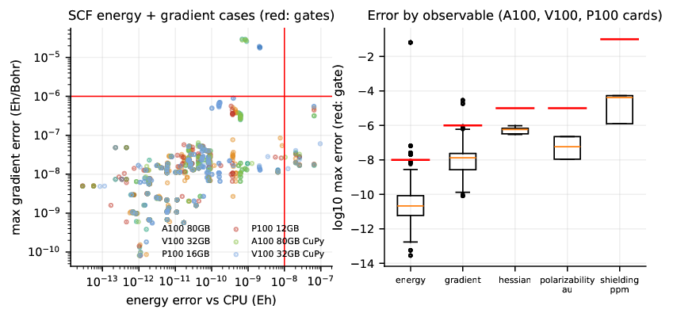
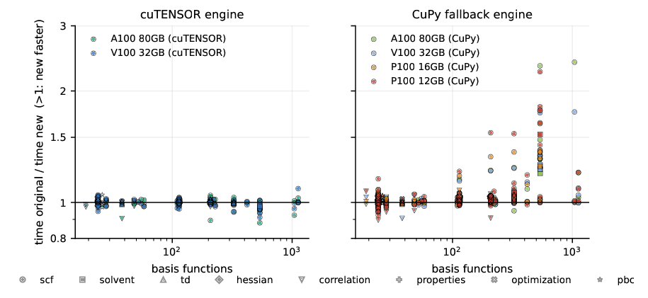
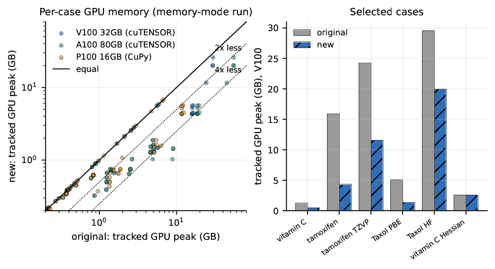
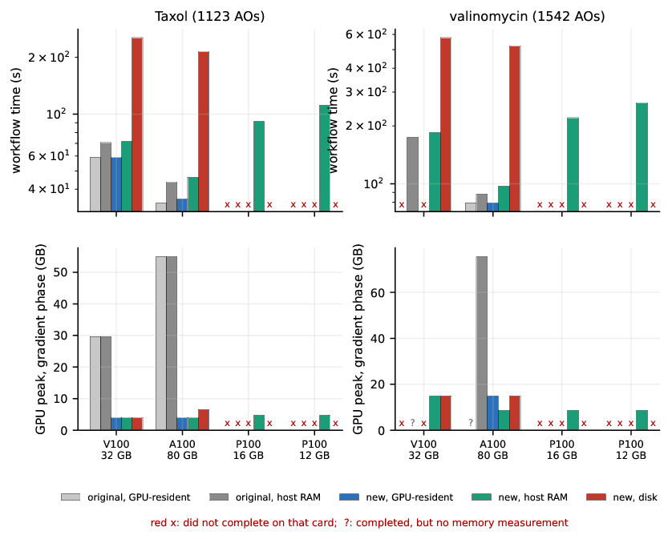
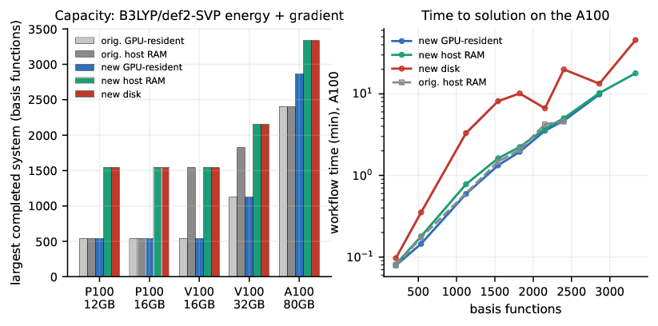

GPU plugin for PySCF
====================

[](https://badge.fury.io/py/gpu4pyscf-cuda11x)

Memory-lean single-GPU density fitting: highlighted results
-----------------------------------------------------------

> [!NOTE]
> This is the `improve-single-gpu` branch of a fork of [pyscf/gpu4pyscf](https://github.com/pyscf/gpu4pyscf).
> It changes the density-fitted (DF) single-GPU path: a bounded fitted-integral build workspace, a disk tier next to the
> host-memory tier, cuBLAS contraction fast paths, and a lower-memory analytic gradient. The installation instructions
> below are those of the upstream project. The full study is in the
> [preprint](reports/lcc_benchmark/GPU4PySCF_preprint.pdf) (LaTeX sources in [`reports/lcc_benchmark/arxiv`](reports/lcc_benchmark/arxiv)).

We compared this version with the unmodified upstream code (commit `9af748a`) and with CPU PySCF 2.14.0 in 127 benchmark
cases (SCF energies and gradients from H<sub>2</sub>O to Taxol with six methods, Hessians, TDA/TDDFT, DF-MP2, CCSD,
polarizabilities, NMR shielding, solvation, dispersion, ECPs, geometry optimizations, periodic systems) on P100 (12 and 16 GB),
V100 (16 and 32 GB) and A100 (80 GB) GPUs, with the cuTENSOR and CuPy contraction engines and three storage tiers for the
fitted integrals. All 14,648 records were audited by an independent program that recomputes every accuracy statistic.

### Summary

| Question | Result |
|---|---|
| Same answer as CPU PySCF? | Yes, for every result that qualified: worst energy error 8.6e-9 Eh (gate 1e-8), worst gradient error 8.5e-8 Eh/Bohr for this version (gate 1e-6). Failures that remain are shared with the original code (wB97M-V, periodic MgO) or are the original code's own (Taxol gradients with hybrid functionals, about 2e-5 Eh/Bohr). |
| Faster with cuTENSOR? | No: median original/new time ratio 1.00 on the A100 and V100, per-case range 0.88-1.09. |
| Faster without cuTENSOR (CuPy `einsum` fallback, P100 cards)? | Yes: 1.2-1.8x for intermediate-size hybrid-functional jobs, up to 2.39x (tamoxifen B3LYP/def2-TZVP, A100, CuPy engine). |
| Less GPU memory? | Median about 2x less tracked memory (up to 4.8x on the V100, 8.6x on the A100). |
| Larger systems? | 1542 basis functions on 12 and 16 GB P100 cards (original: 537), 3336 basis functions (417 atoms) on an 80 GB A100 (original: 2400). |
| Against the CPU? | Median 46x (A100), 36x (V100), 23x (P100-16) faster than the best CPU lane for jobs that take the CPU at least 20 s; up to 328x (A100) for finite-difference Hessians. |

### Accuracy



Every GPU result is compared with an independent CPU result. Original and new code agree with the CPU to within the gates
declared before any performance run, and they cannot be distinguished from each other in accuracy at this level.

### Speed

Original/new time ratio (above 1 means this version is faster; per-case range in brackets, all cases where both versions qualified):

| Stratum | Engine | Median | Range |
|---|---|---|---|
| A100 80 GB | cuTENSOR | 1.00 | 0.88-1.04 |
| V100 32 GB | cuTENSOR | 1.00 | 0.91-1.09 |
| A100 80 GB | CuPy fallback | 1.01 | 0.95-2.39 |
| V100 32 GB | CuPy fallback | 1.01 | 0.91-1.76 |
| P100 16 GB | CuPy fallback | 1.01 | 0.97-1.63 |
| P100 12 GB | CuPy fallback | 1.02 | 0.90-2.26 |



With cuTENSOR installed the new fast paths are bypassed and the speed is unchanged; the benefit is the removal of a
penalty that only the CuPy fallback engine pays. Slowdowns of up to 12% occur in individual Hartree-Fock and
hybrid-functional cases of tamoxifen size.

### GPU memory

| Case (V100, def2-SVP unless noted) | Original | This version | Reduction |
|---|---|---|---|
| Tamoxifen B3LYP | 15.9 GB | 4.4 GB | 3.7x |
| Tamoxifen B3LYP, def2-TZVP | 24.3 GB | 11.6 GB | 2.1x |
| Taxol LDA / PBE / TPSS | about 5 GB | 1-1.5 GB | 3.5-4.8x |
| Taxol HF / B3LYP | 29.5 GB | 20.0 GB | 1.5x |
| Taxol gradient, any storage tier | 29.6 GB (54.9 GB on A100) | 4.1 GB | 7x (13x on A100) |



The figures are peaks of live CuPy storage, not total device memory. The original code sizes its gradient workspace from the
free memory of the card, so its peak depends on the card.

### Storage tiers and capacity

Taxol B3LYP/def2-SVP, V100: 59.3 s with the fitted integrals on the GPU, 71.7 s in pinned host memory (+21%), 254.5 s from disk,
with a 4.1 GB gradient peak in every tier.



Largest system completed with a B3LYP/def2-SVP energy and full-response gradient:

| Card | Original (best tier) | This version (best tier) |
|---|---|---|
| P100 12 GB | tamoxifen, 537 basis functions | valinomycin, 1542 (host) |
| P100 16 GB | tamoxifen, 537 | valinomycin, 1542 (host) |
| V100 16 GB | valinomycin, 1542 (host) | valinomycin, 1542 (host) |
| V100 32 GB | 76 waters, 1824 (host) | glycine chain, 2154 (host) |
| A100 80 GB | 100 waters, 2400 | 139 waters, 3336 (host: 17.9 min; disk: 45.6 min) |



Beyond these rungs the limit is a tensor of N<sub>aux</sub>N<sub>occ</sub><sup>2</sup> elements held by the analytic gradient on the GPU;
offloading it to host memory is the next step.

### Reproducing

The benchmark suite is in [`benchmarks/single_gpu/qm_suite`](benchmarks/single_gpu/qm_suite) and its [description](benchmarks/single_gpu/qm_suite/BENCHMARK_SUITE.md);
the audited summary data and the scripts that build the tables and figures are in [`reports/lcc_benchmark`](reports/lcc_benchmark).
Raw per-job records (about 66 GB) are not in the repository.

Installation
--------

> [!NOTE]
> The compiled binary packages support compute capability 7.0 and later (Volta and later, such as Tesla V100, RTX 20 series and later).

To check your installed CUDA Toolkit version, run
```sh
nvcc --version
```
Then, install the appropriate package based on your CUDA version:

| Platform      | Command                               | cutensor (**highly recommended**)|
----------------| --------------------------------------|----------------------------------|
| **CUDA 11.x** |  ```pip3 install gpu4pyscf-cuda11x``` | ```pip3 install cutensor-cu11``` |
| **CUDA 12.x** |  ```pip3 install gpu4pyscf-cuda12x``` | ```pip3 install cutensor-cu12``` |
| **CUDA 13.x** |  ```pip3 install gpu4pyscf-cuda13x``` | ```pip3 install cutensor-cu13``` |

The versions of CuPy and cuTENSOR are strongly interdependent and should not be combined arbitrarily.
The recommended combinations include:
1. CuPy 13.3.0 + cuTENSOR 2.0.2
2. CuPy 13.4.1 + cuTENSOR 2.2.0

Using other versions or combinations may lead to failures in functionality. 
We **recommend** creating a dedicated environment using:
```sh
pip3 install --no-cache-dir -r requirements.txt
```
This ensures compatibility and reproducibility, especially since this configuration is used in our nightly benchmarks.

Compilation
--------
To compile the package, run the following commands:
```sh
git clone https://github.com/pyscf/gpu4pyscf.git
cd gpu4pyscf
cmake -S gpu4pyscf/lib -B build/temp.gpu4pyscf
cmake --build build/temp.gpu4pyscf -j 4
CURRENT_PATH=`pwd`
export PYTHONPATH="${PYTHONPATH}:${CURRENT_PATH}"
```
Then install cutensor and cupy for acceleration (please switch the versions according to your runtime CUDA environment!)
```sh
pip3 install cutensor-cu12 cupy-cuda12x
```
There shouldn't be cupy or cutensor compilation during pip install process. If you see the following warning at the beginning of a gpu4pyscf job, it implies problems with cupy and cutensor installation (likely a version mismatch, or multiple versions of same package installed).
```
<repo_path>/gpu4pyscf/lib/cutensor.py:<line_number>: UserWarning: using cupy as the tensor contraction engine.
```

For source builds, GPU targets can be selected explicitly. For example, on a
GB10 with a CUDA compiler supporting SM121:

```sh
cmake -S gpu4pyscf/lib -B build/single-gpu -DCMAKE_CUDA_ARCHITECTURES=121
cmake --build build/single-gpu -j 4
```

Without an override, the build queries nvcc and selects supported generic
architectures plus a PTX image for forward compatibility. Explicit
`CUDA_ARCHITECTURES`, `CMAKE_CUDA_ARCHITECTURES`, and `CUDAARCHS` choices take
precedence over automatic selection. Other CUDA compilers require an explicit
architecture selection.

The [single-GPU qualification suite](benchmarks/single_gpu/README.md) records
component performance and matched CPU/GPU scientific results separately.
The [support matrix](docs/single-gpu-support.md) distinguishes tested component
behavior from native package qualification and published wheel coverage.
The [bounded gradient workspace measurements](benchmarks/single_gpu/README.md#bounded-gradient-workspaces-and-direct-coulomb-contractions)
document reduced transient GPU allocations and the remaining large-system
storage limits, with host RAM measured separately.
Optional [disk-backed DF storage](benchmarks/single_gpu/README.md#disk-backed-df-and-cpugpu-communication)
provides a single-GPU capacity path. GPU caching remains experimental and off
by default because repeated timing found a small-case SCF iteration regression.
When the cuTENSOR bindings are unavailable in CuPy, the CuPy contraction fallback
is used; installing the cuTENSOR library alone does not supply those bindings.
The [corrected-code optimization campaign](benchmarks/single_gpu/README.md#corrected-code-optimization-campaign-2026-10-18)
records measured short-block exchange gains and a 512 MiB estimated grid-weight
response batch target for full-response RKS gradients. The target limits that
temporary batch rather than total GPU or host memory; all grids and response
terms are retained.
The [resident DF construction measurements](benchmarks/single_gpu/README.md#bounded-resident-df-build-workspace-2026-10-18)
qualify a configurable 4 GiB build-buffer target for bases without general
contractions. Taxol peak tracked CuPy storage falls from 30.10 to 20.05 GB,
with a 0.286% median workflow time increase across three fresh timing pairs.
This target excludes persistent integrals, metric and native workspaces.
The [comprehensive code review](benchmarks/single_gpu/code_review_results/REPORT.md)
documents correctness repairs, output-buffer reuse and grid temporary reduction,
with fresh CPU-referenced workflows and separately measured component results.

Features
--------
- Density fitting scheme and direct SCF scheme;
- SCF, analytical gradient, and analytical Hessian calculations for Hartree-Fock and DFT;
- LDA, GGA, mGGA, hybrid, and range-separated functionals via [libXC](https://gitlab.com/libxc/libxc/-/tree/master/);
- Spin-conserved and spin-flip TDA and TDDFT for excitated states;
- Geometry optimization and transition state search via [geomeTRIC](https://geometric.readthedocs.io/en/latest/);
- Atomic Simulation Environment ([ASE](https://gitlab.com/ase/ase)) interface;
- Dispersion corrections via [DFTD3](https://github.com/dftd3/simple-dftd3) and [DFTD4](https://github.com/dftd4/dftd4);
- Analytical gradient and analytical Hessian for nonlocal functional correction (vv10);
- GPU accelerated ECP;
- PCM models, their analytical gradients, and analytical Hessian matrix;
- SMD solvent model;
- Unrestricted Hartree-Fock and unrestricted DFT, gradient, and Hessian;
- CHELPG, ESP, and RESP atomic charge;

The following features are still in the experimental stage
- MP2/DF-MP2 and CCSD;
- Polarizability, IR, and NMR shielding;
- Raman spectrum;
- QM/MM with PBC;
- Multi-GPU for both direct SCF and density fitting;
- SCF and DFT with periodic boundary condition;
- Non-adiabatic coupling for TDDFT;
- Energy decomposition analysis;

Limitations
--------
- Atomic basis up to g orbitals;
- Auxiliary basis up to i orbitals;
- Density fitting scheme up to ~168 atoms with def2-tzvpd basis, bounded by CPU memory;
- meta-GGA with density laplacian;
- Double hybrid functionals are not supported;
- Hessian of TDDFT is not supported;

Examples
--------
```python
import pyscf

atom ='''
O       0.0000000000    -0.0000000000     0.1174000000
H      -0.7570000000    -0.0000000000    -0.4696000000
H       0.7570000000     0.0000000000    -0.4696000000
'''

mol = pyscf.M(atom=atom, basis='def2-tzvpp')
mf = rks.RKS(mol, xc='b3lyp').density_fit().to_gpu()  # move PySCF object to GPU4PySCF object

e_dft = mf.kernel()  # compute total energy
print(f"total energy = {e_dft}")

g = mf.Gradients()
g_dft = g.kernel()   # compute analytical gradient

h = mf.Hessian()
h_dft = h.kernel()   # compute analytical Hessian
```

Find more examples in [gpu4pyscf/examples](https://github.com/pyscf/gpu4pyscf/tree/master/examples)

Benchmarks
--------
Speedup with GPU4PySCF v0.6.0 on A100-80G over Q-Chem 6.1 on 32-cores CPU (density fitting, SCF, def2-tzvpp, def2-universal-jkfit, B3LYP, (99,590))

| mol               |   natm |    LDA |    PBE |   B3LYP |    M06 |   wB97m-v |
|:------------------|-------:|-------:|-------:|--------:|-------:|----------:|
| 020_Vitamin_C     |     20 |   2.86 |   6.09 |   13.11 |  11.58 |     17.46 |
| 031_Inosine       |     31 |  13.14 |  15.87 |   16.57 |  25.89 |     26.14 |
| 033_Bisphenol_A   |     33 |  12.31 |  16.88 |   16.54 |  28.45 |     28.82 |
| 037_Mg_Porphin    |     37 |  13.85 |  19.03 |   20.53 |  28.31 |     30.27 |
| 042_Penicillin_V  |     42 |  10.34 |  13.35 |   15.34 |  22.01 |     24.2  |
| 045_Ochratoxin_A  |     45 |  13.34 |  15.3  |   19.66 |  27.08 |     25.41 |
| 052_Cetirizine    |     52 |  17.79 |  17.44 |   19    |  24.41 |     25.87 |
| 057_Tamoxifen     |     57 |  14.7  |  16.57 |   18.4  |  24.86 |     25.47 |
| 066_Raffinose     |     66 |  13.77 |  14.2  |   20.47 |  22.94 |     25.35 |
| 084_Sphingomyelin |     84 |  14.24 |  12.82 |   15.96 |  22.11 |     24.46 |
| 095_Azadirachtin  |     95 |   5.58 |   7.72 |   24.18 |  26.84 |     25.21 |
| 113_Taxol         |    113 |   5.44 |   6.81 |   24.58 |  29.14 |    nan    |

Find more benchmarks in [gpu4pyscf/benchmarks](https://github.com/pyscf/gpu4pyscf/tree/master/benchmarks)

References
---------
```
@misc{li2024introducting,
      title={Introducing GPU-acceleration into the Python-based Simulations of Chemistry Framework},
      author={Rui Li and Qiming Sun and Xing Zhang and Garnet Kin-Lic Chan},
      year={2024},
      eprint={2407.09700},
      archivePrefix={arXiv},
      primaryClass={physics.comp-ph},
      url={https://arxiv.org/abs/2407.09700},
}

@misc{wu2024enhancing,
      title={Enhancing GPU-acceleration in the Python-based Simulations of Chemistry Framework},
      author={Xiaojie Wu and Qiming Sun and Zhichen Pu and Tianze Zheng and Wenzhi Ma and Wen Yan and Xia Yu and Zhengxiao Wu and Mian Huo and Xiang Li and Weiluo Ren and Sheng Gong and Yumin Zhang and Weihao Gao},
      year={2024},
      eprint={2404.09452},
      archivePrefix={arXiv},
      primaryClass={physics.comp-ph},
      url={https://arxiv.org/abs/2404.09452},
}
```
